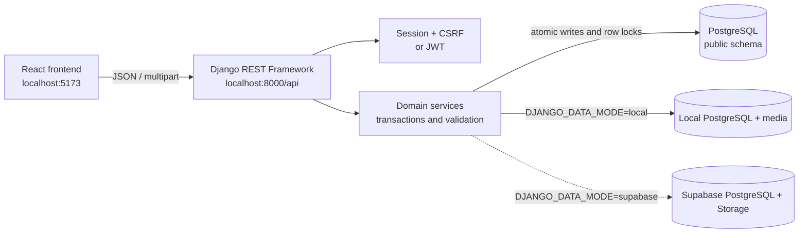
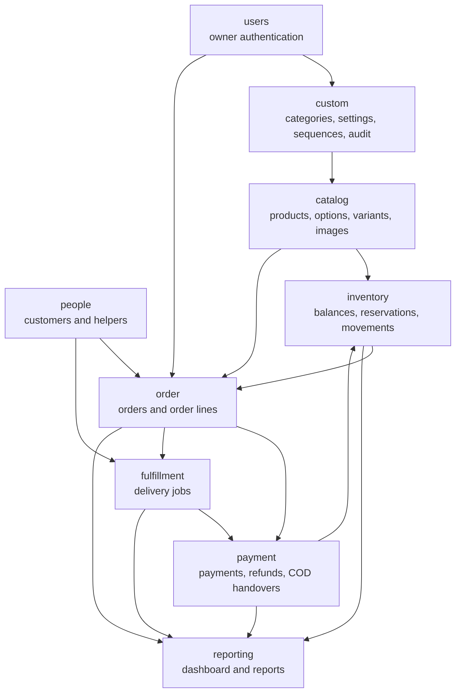

# Dina Shop Backend

Dina Shop uses Django and Django REST Framework as the server-authoritative backend for authentication, catalog management, inventory, people, orders, payments, refunds, delivery fulfilment, dashboard summaries, and reports.

- API base: `http://localhost:8000/api/`
- Interactive API documentation: `http://localhost:8000/api/docs/`
- OpenAPI schema: `http://localhost:8000/api/schema/`
- Detailed Markdown documentation: [docs/api/README.md](docs/api/README.md)

## General architecture





The arrows show important domain dependencies, not HTTP calls between apps. API views delegate business changes to services; services own validation, audit events, transactions, locking, idempotency, and immutable history creation.

## Applications and APIs

| App | Responsibility | API prefix | Documentation |
|---|---|---|---|
| `users` | Owner login, sessions, JWT, profile, notification receipts | `/api/users/` | [Users API](docs/api/users/diagram.md) |
| `custom` | Categories, business settings, numbering, audit history | `/api/custom/` | [Custom API](docs/api/custom/diagram.md) |
| `catalog` | Products, images, options, variants, pricing history | `/api/catalog/` | [Catalog API](docs/api/catalog/diagram.md) |
| `inventory` | Stock balances, reservations, receipts, adjustments, movements | `/api/inventory/` | [Inventory API](docs/api/inventory/diagram.md) |
| `people` | Customers and delivery helpers | `/api/people/` | [People API](docs/api/people/diagram.md) |
| `order` | Catalog/special orders, reservations, fulfilment, receipts | `/api/order/` | [Order API](docs/api/order/diagram.md) |
| `payment` | Payments, refunds, refund lines, COD handovers | `/api/payment/` | [Payment API](docs/api/payment/diagram.md) |
| `fulfillment` | Delivery assignment, start, delivery, and failure | `/api/fulfillment/` | [Fulfilment API](docs/api/fulfillment/diagram.md) |
| `storefront` | Anonymous, read-only public catalog facade | `/api/public/` | [Public storefront API](docs/api/public/README.md) |
| `reporting` | Read-only dashboard summaries, nine reports, and CSV exports | `/api/dashboard/`, `/api/report/` | [Reporting API](docs/api/reporting/diagram.md) |

`reporting` is a project-level query package rather than a Django model app: it reads the owning domain models and never creates duplicate reporting tables. `DocumentSequence` is internal and has no public API. The `storefront` facade is intentionally read-only: it does not provide checkout, customer accounts, or public order creation.

## Localization foundation

Django internationalization is enabled for English (`en`) and Tetum (`tet`).
`LocaleMiddleware` remains the translation authority. Because Django only
considers a language catalog available after a `.mo` file exists,
`ConfiguredLanguageMiddleware` safely activates the explicitly configured
`en` or `tet` request header during this foundation phase. This avoids a fake
compiled catalog while still returning the negotiated language in
`Content-Language`. English is the default and fallback language.

Language catalogs are separated under:

```text
locale/
├── en/LC_MESSAGES/django.po
└── tet/LC_MESSAGES/django.po
```

React owns interface text and displayed status labels. Django will own
translated serializer validation, permissions, and backend-generated messages
when those strings are marked with `gettext()` or `gettext_lazy()`. Product and
category names, customer details, addresses, notes, identifiers, SKUs, machine
statuses, and other database values remain untranslated.

When backend messages are ready for translation, update and compile the
catalogs from the backend directory:

```powershell
python manage.py makemessages -l en -l tet
python manage.py compilemessages
```

The source English message remains the canonical message ID. Compiled `.mo`
files are intentionally not created while the catalogs contain headers only.

## Main tools currently used

- Python, Django, and Django REST Framework
- PostgreSQL with `psycopg`; the application uses the `public` schema
- `django-environ` for environment configuration
- `django-filter` for API filtering and DRF pagination/search/ordering
- Django sessions and CSRF for browser authentication
- Simple JWT for optional non-browser clients
- `django-cors-headers` for the local React origin
- `drf-spectacular` for OpenAPI and Swagger UI
- Pillow for validated image processing and WebP conversion
- `django-storages` and `boto3` for Supabase S3-compatible production media

No Celery, Redis, crispy forms, payment gateway, or background worker is required by the current backend.

## Local setup

From this backend directory:

```powershell
..\venv\Scripts\Activate.ps1
python manage.py migrate
python manage.py createsuperuser
python manage.py runserver localhost:8000
```

Copy `.env.example` to `.env` and set `DJANGO_DATA_MODE=local` plus `LOCAL_DATABASE_URL` for local PostgreSQL and local `media/`. Set `DJANGO_DATA_MODE=supabase` plus `SUPABASE_DATABASE_URL` and the Supabase Storage variables to intentionally use Supabase PostgreSQL and Supabase Storage even while `DJANGO_ENV=development`; this is useful for testing shared data but must never be treated as disposable local data. Legacy `POSTGRES_*` variables are not used by this paired configuration. Keep React at `http://localhost:5173` so the configured CORS and CSRF origins match exactly. `DJANGO_ENV` controls security/debug behavior, while `DJANGO_DATA_MODE` controls the paired database and media backend.

## API conventions

- All operational endpoints require authentication except the documented authentication entry points and the read-only `/api/public/` storefront endpoints.
- Browser writes require the session cookie and `X-CSRFToken` header.
- JSON fields use `snake_case`, IDs are UUID strings, money uses integer cents, and timestamps use ISO-8601 UTC.
- The backend calculates prices, totals, balances, refunds, and stock values.
- Financial and inventory history cannot be edited or deleted through the API.
- Duplication-sensitive commands require a UUID `Idempotency-Key` header.
- Order-changing commands use the last observed `version`; stale changes return `409 stale_order`.

See the [API documentation index](docs/api/README.md) for model-level endpoints, examples, validation errors, and app diagrams.

## Validation commands

```powershell
python manage.py check
python manage.py makemigrations --check --dry-run
python manage.py test
python manage.py spectacular --validate --file schema.yml
```

Production deployments should additionally run `python manage.py check --deploy` with production environment variables, apply migrations before serving traffic, and verify database backups and media-storage access.
