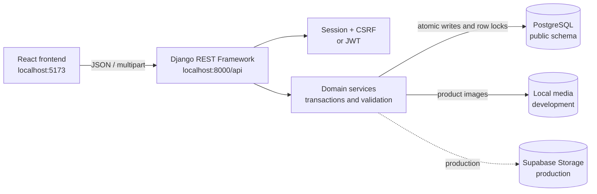
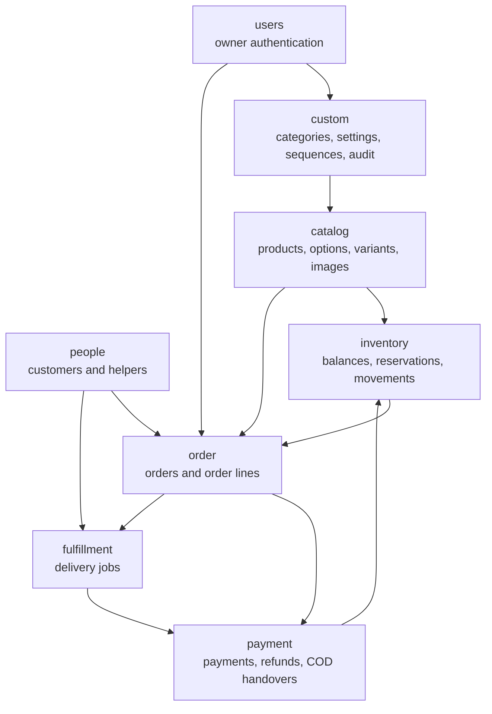

# Dina Shop Backend

Dina Shop uses Django and Django REST Framework as the server-authoritative backend for authentication, catalog management, inventory, people, orders, payments, refunds, and delivery fulfilment.

- API base: `http://localhost:8000/api/`
- Interactive API documentation: `http://localhost:8000/api/docs/`
- OpenAPI schema: `http://localhost:8000/api/schema/`
- Detailed Markdown documentation: [docs/api/README.md](docs/api/README.md)

## General architecture





The arrows show important domain dependencies, not HTTP calls between apps. API views delegate business changes to services; services own validation, audit events, transactions, locking, idempotency, and immutable history creation.

## Applications and APIs

| App | Responsibility | API prefix | Documentation |
|---|---|---|---|
| `users` | Owner login, sessions, JWT, profile, notification receipts | `/api/users/` | [Users API](docs/api/users/diagram.md) |
| `custom` | Categories, business settings, numbering, audit history | `/api/custom/` | [Custom API](docs/api/custom/diagram.md) |
| `catalog` | Products, images, options, variants, pricing history | `/api/catalog/` | [Catalog API](docs/api/catalog/diagram.md) |
| `inventory` | Stock balances, reservations, receipts, adjustments, movements | `/api/inventory/` | [Inventory API](docs/api/inventory/diagram.md) |
| `people` | Customers and delivery helpers | `/api/people/` | [People API](docs/api/people/diagram.md) |
| `order` | Catalog/special orders, reservations, fulfilment, receipts | `/api/order/` | [Order API](docs/api/order/diagram.md) |
| `payment` | Payments, refunds, refund lines, COD handovers | `/api/payment/` | [Payment API](docs/api/payment/diagram.md) |
| `fulfillment` | Delivery assignment, start, delivery, and failure | `/api/fulfillment/` | [Fulfilment API](docs/api/fulfillment/diagram.md) |

`DocumentSequence` is internal and has no public API. Reports, dashboards, external messaging, payment gateways, carts, and storefront APIs are not implemented yet.

## Main tools currently used

- Python, Django, and Django REST Framework
- PostgreSQL with `psycopg`; the application uses the `public` schema
- `django-environ` for environment configuration
- `django-filter` for API filtering and DRF pagination/search/ordering
- Django sessions and CSRF for browser authentication
- Simple JWT for optional non-browser clients
- `django-cors-headers` for the local React origin
- `drf-spectacular` for OpenAPI and Swagger UI
- Pillow for validated image processing and WebP conversion
- `django-storages` and `boto3` for Supabase S3-compatible production media

No Celery, Redis, crispy forms, payment gateway, or background worker is required by the current backend.

## Local setup

From this backend directory:

```powershell
..\venv\Scripts\Activate.ps1
python manage.py migrate
python manage.py createsuperuser
python manage.py runserver localhost:8000
```

Copy `.env.example` to `.env` and configure the local PostgreSQL credentials first. Keep React at `http://localhost:5173` so the configured CORS and CSRF origins match exactly. Development product images are stored under `media/`; production selects Supabase storage through environment settings.

## API conventions

- All application endpoints require authentication except the documented authentication entry points.
- Browser writes require the session cookie and `X-CSRFToken` header.
- JSON fields use `snake_case`, IDs are UUID strings, money uses integer cents, and timestamps use ISO-8601 UTC.
- The backend calculates prices, totals, balances, refunds, and stock values.
- Financial and inventory history cannot be edited or deleted through the API.
- Duplication-sensitive commands require a UUID `Idempotency-Key` header.
- Order-changing commands use the last observed `version`; stale changes return `409 stale_order`.

See the [API documentation index](docs/api/README.md) for model-level endpoints, examples, validation errors, and app diagrams.

## Validation commands

```powershell
python manage.py check
python manage.py makemigrations --check --dry-run
python manage.py test
python manage.py spectacular --validate --file schema.yml
```

Production deployments should additionally run `python manage.py check --deploy` with production environment variables, apply migrations before serving traffic, and verify database backups and media-storage access.
