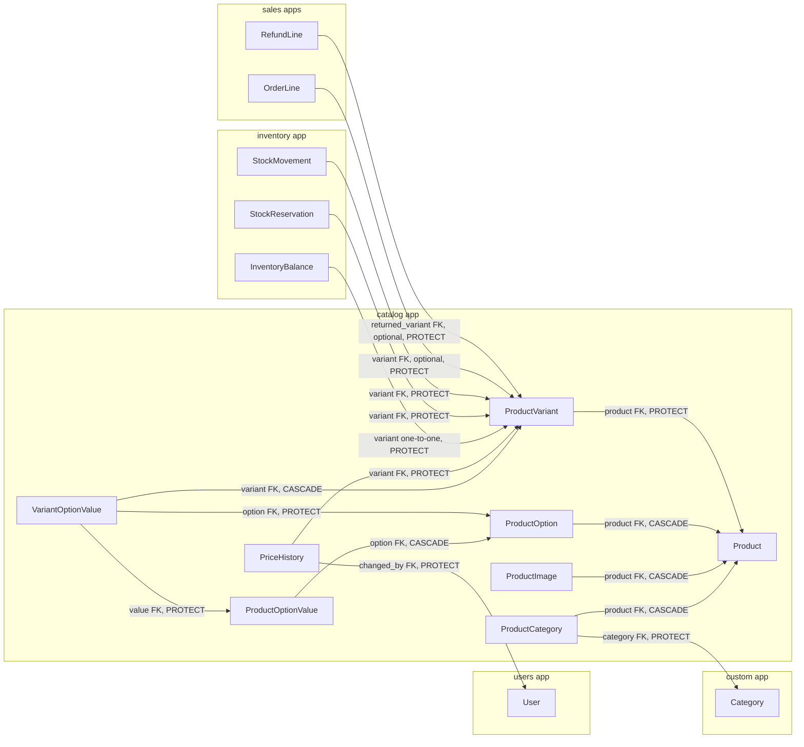
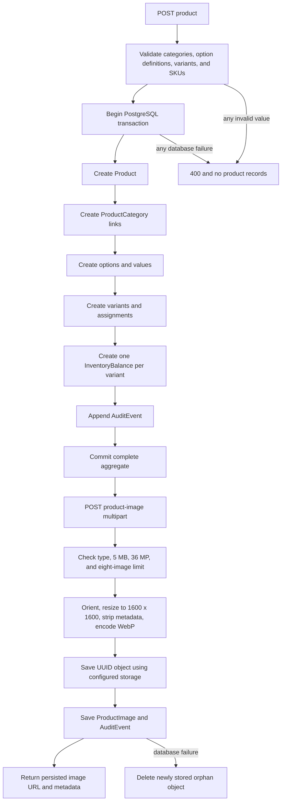

# Catalog app diagrams

The catalog is an aggregate rooted at `Product`. Options, variants, images, pricing history, categories, stock, orders, and refunds integrate through this root.

## Model relationships

`ProductCategory` is the many-to-many bridge between products and categories. `VariantOptionValue` is the bridge that assigns exactly one value for each option to a variant. `InventoryBalance` is created for every variant and is one-to-one.

## Atomic product creation and image upload

Images are intentionally outside the product transaction because local or Supabase object storage cannot participate in a PostgreSQL rollback. Pricing commands lock `ProductVariant`, update its current price, and append immutable `PriceHistory` rows.

## Related documentation

- [Product](product.md), [ProductCategory](product_category.md), and [ProductImage](product_image.md)
- [ProductOption](product_option.md), [ProductOptionValue](product_option_value.md), and [VariantOptionValue](variant_option_value.md)
- [ProductVariant](product_variant.md) and [PriceHistory](price_history.md)
- [API conventions](../README.md)
