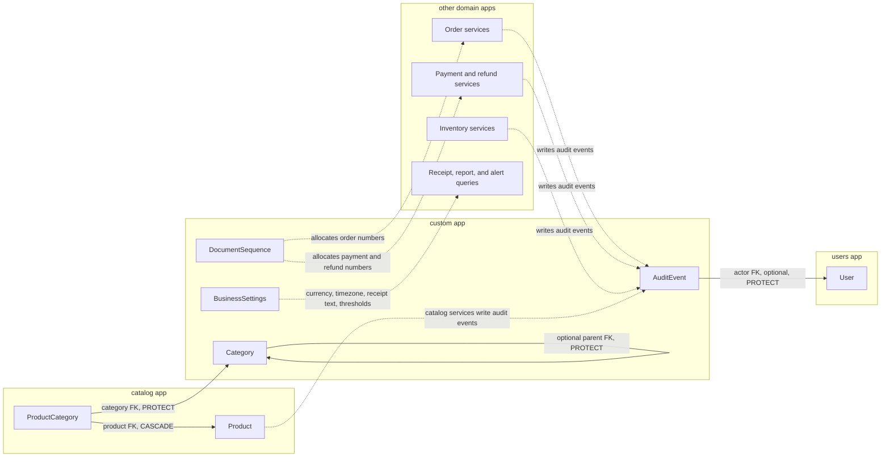
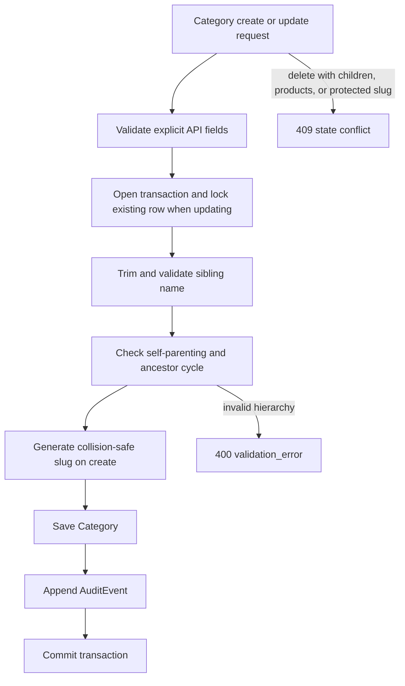

# Custom app diagrams

The `custom` app owns shared master data, singleton business configuration, document numbering, and the cross-domain audit trail.

## Model and integration relationships

Solid arrows are database relationships. Dashed arrows are service/query dependencies without foreign keys. `AuditEvent.entity_type` and `entity_id` are a generic reference, so an audit row describes many model types without creating a database foreign key to each table.

## Category update workflow

`BusinessSettings` uses the fixed key `default`. `DocumentSequence` is internal-only and must be locked with `select_for_update()` when a number is allocated. `AuditEvent` is read-only through the API.

## Related documentation

- [Category](category.md)
- [BusinessSettings](business_settings.md)
- [DocumentSequence](document_sequence.md)
- [AuditEvent](audit_event.md)
- [API conventions](../README.md)
