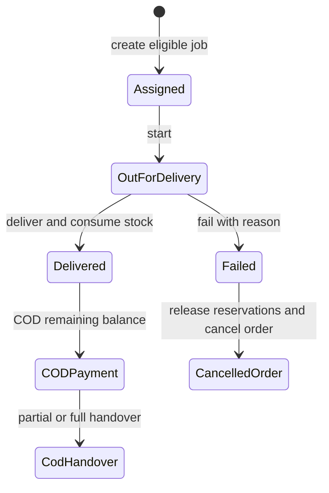

# Fulfillment model and command flow

`DeliveryJob` belongs to one delivery `Order`, one active `Helper`, and optionally one immutable COD `Payment`. See [DeliveryJob](delivery_job.md), [Order](../order/order.md), and [COD handover](../payment/cod_handover.md).
