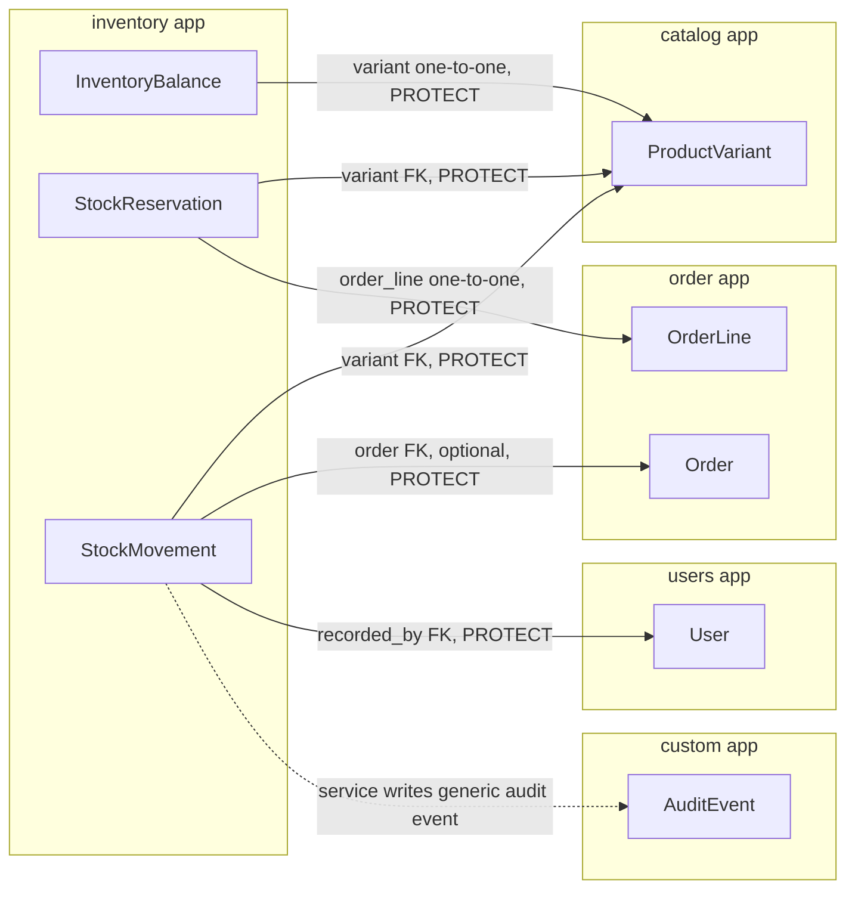
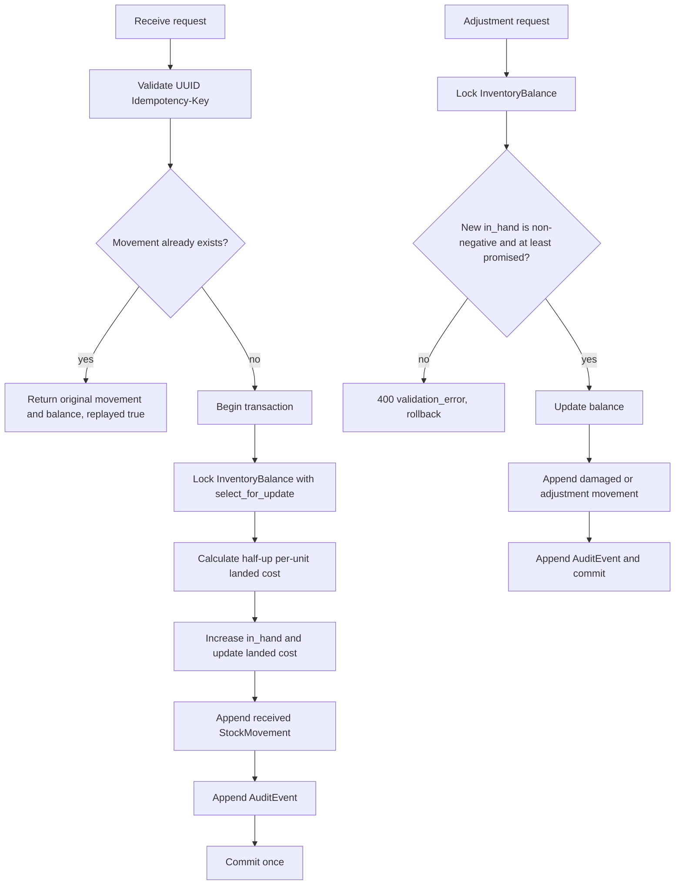
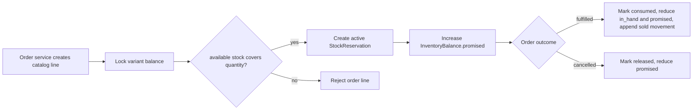

# Inventory app diagrams

Inventory separates the mutable current balance from explicit reservations and immutable movement history.

## Model relationships

`InventoryBalance` is the current snapshot: `available = in_hand - promised`. `StockReservation` explains promised quantities per order line. `StockMovement` is the append-only ledger explaining how stock changed.

## Receiving and adjustment commands

## Reservation integration in the order phase

The reservation workflow is documented for integration, but its mutation endpoints remain deferred until the order API phase. Phase one exposes reservations read-only.

## Related documentation

- [InventoryBalance](inventory_balance.md)
- [StockReservation](stock_reservation.md)
- [StockMovement](stock_movement.md)
- [API conventions](../README.md)
