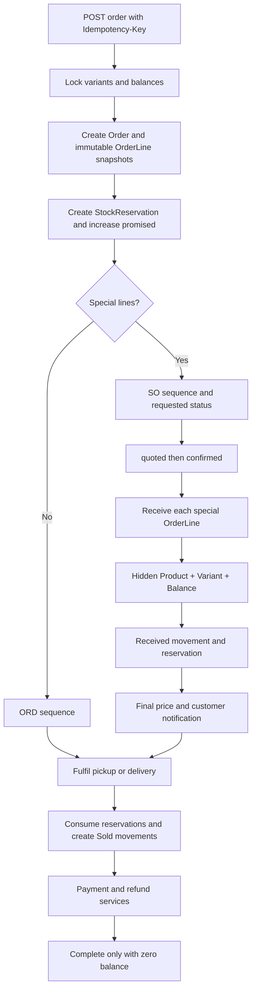

# Order model and transaction flow

`Order` integrates with `Customer`, catalog variants, inventory reservations/movements, payments/refunds, and one optional delivery job. See [Order](order.md), [OrderLine](order_line.md), and [Inventory](../inventory/diagram.md).
