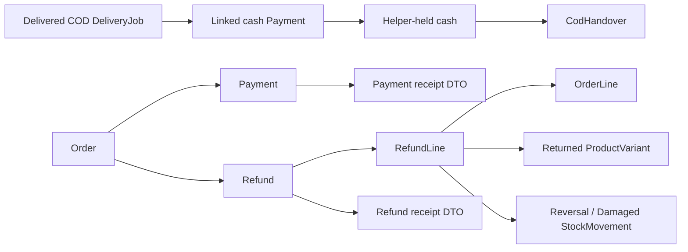

# Payment, refund, and COD flow

All financial records are append-only. Payment status, refundable values, cash payout, and COD held amounts are derived by backend services.

See [Payment](payment.md), [Refund](refund.md), [RefundLine](refund_line.md), and [COD handover](cod_handover.md).
