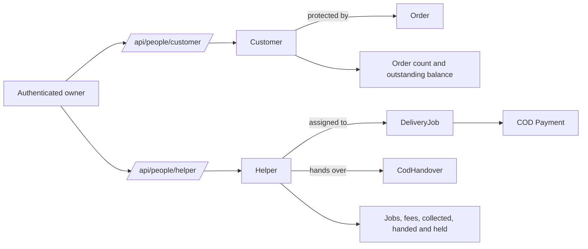

# People model and API flow

Customers and helpers never authenticate. Historical relations use `PROTECT`; operational removal is deactivation. The seeded walk-in customer is valid only for ordinary pickup orders.

See [Customer](customer.md), [Helper](helper.md), and [API conventions](../README.md).
