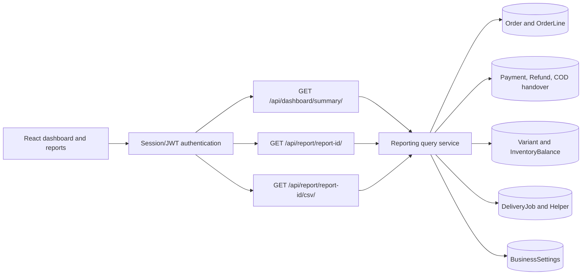

# Reporting integration diagram

Reporting is a read-only project package. It owns no database models or migrations; it combines persisted records from their domain apps at request time.

Money stays in integer cents in JSON. CSV exports format money as decimal currency values for spreadsheet use. Dates are inclusive and interpreted using the configured business timezone.

- [Dashboard summary](dashboard.md)
- [Reports and CSV exports](report.md)
- [API index](../README.md)
