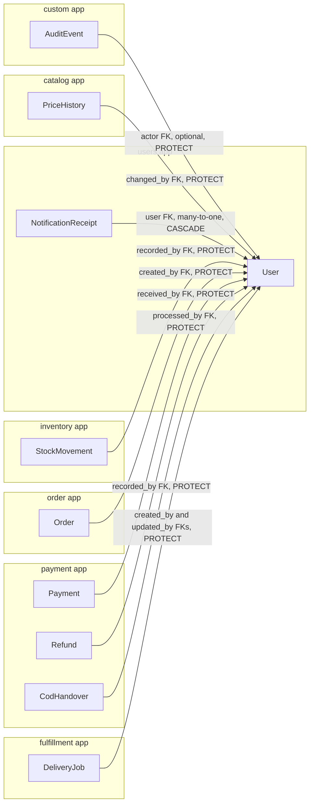
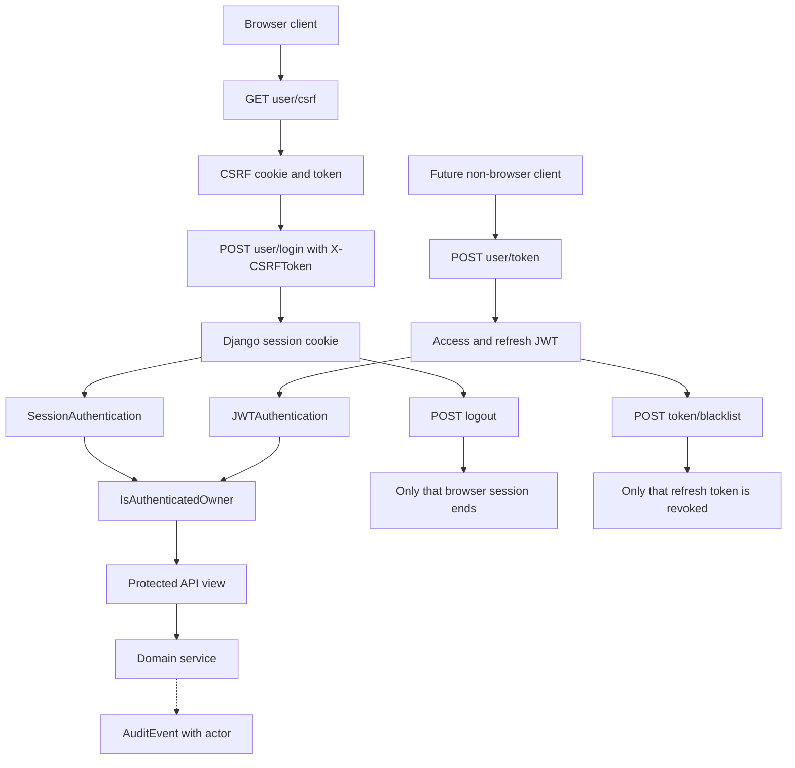

# Users app diagrams

These diagrams show how authentication ownership and audit attribution connect the `users` app to the rest of the backend.

## Model relationships

`NotificationReceipt` is the only operational child deleted with its user. Historical business records use `PROTECT`, which prevents removing the actor while those records exist. In v1 every active authenticated `User` is treated as an owner; customers and helpers are separate records and never authenticate.

## Browser session and JWT interaction

Session-authenticated `POST`, `PUT`, `PATCH`, and `DELETE` requests require the CSRF header. JWT requests use the bearer access token and do not use Django session CSRF validation.

## Related documentation

- [User API](user.md)
- [NotificationReceipt API](notification_receipt.md)
- [API conventions](../README.md)
